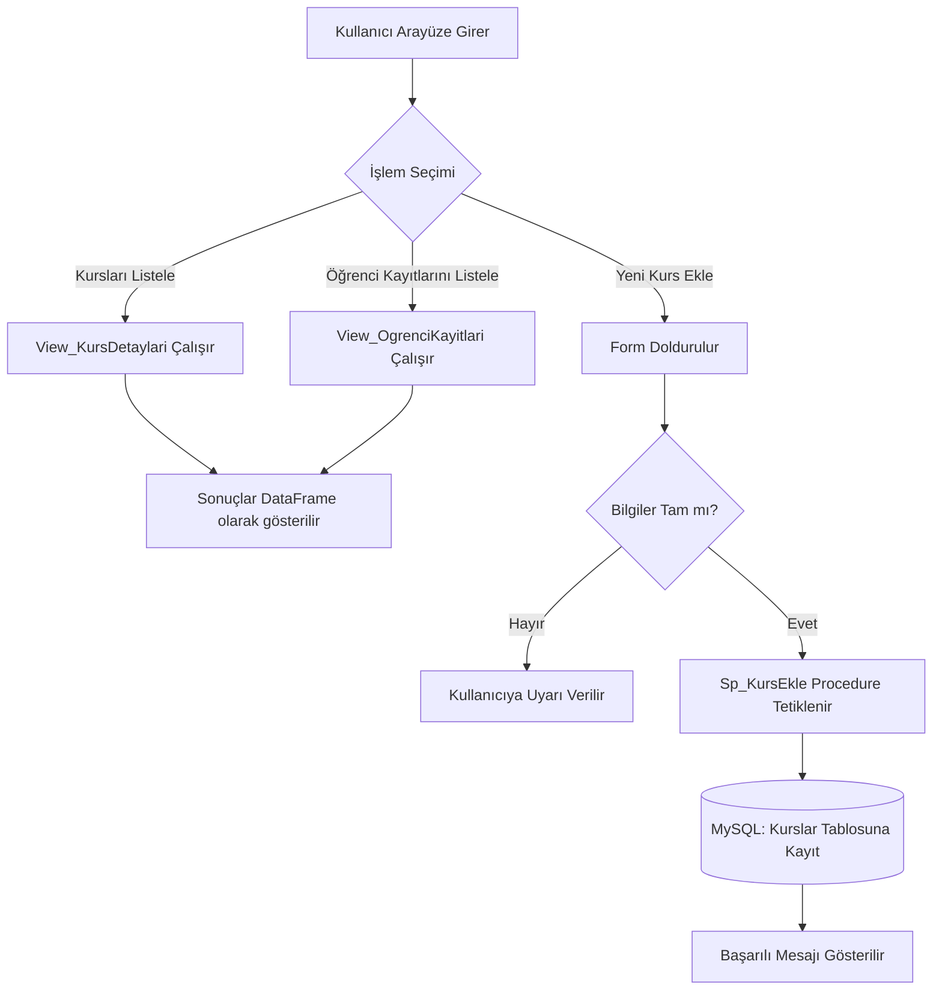
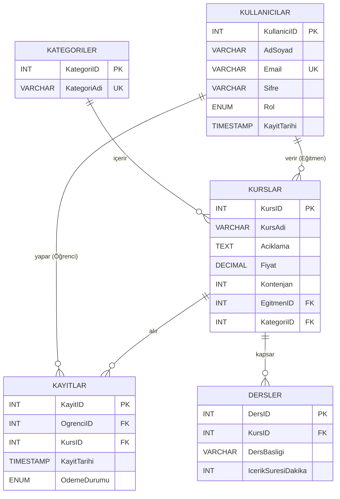

# Online Kurs Yönetim Sistemi (TBL331 Dönem Projesi)

**Kocaeli Üniversitesi - Bilişim Sistemleri Mühendisliği Bölümü**
**TBL331: Veritabanı Yönetim Sistemleri (2025-2026 Bahar)**

**Grup No:** 178
**Grup Üyeleri:** Mücahid Şafak, Faruk Arslan

---

## 1. Problem Tanımı
Günümüzde uzaktan eğitimin yaygınlaşmasıyla birlikte, kursların, öğrencilerin, eğitmenlerin ve kayıt süreçlerinin dijital bir ortamda güvenilir şekilde yönetilmesi büyük bir ihtiyaç haline gelmiştir. Bu proje kapsamında ele alınan problem; bir online eğitim platformundaki kursların kontenjanlarının aşılmasını engelleyen, öğrencilerin kayıt ve ödeme durumlarını takip eden, eğitmenleri ilgili kurslarla eşleştiren ve tüm bu verileri tutarlı (veri bütünlüğü kurallarına uygun) bir şekilde saklayarak raporlayabilen merkezi bir veritabanı yönetim sistemi tasarlamaktır.

## 2. Yapılan Araştırmalar
Proje geliştirilmeden önce ve geliştirme aşamasında aşağıdaki araştırmalar yapılmıştır:
* **Veritabanı Normalizasyonu:** Tabloların 5N (Normalizasyon) kurallarına uygun olarak tasarlanabilmesi için veri tekrarını önleyecek yapısal kurgular (Kullanıcıların Rol enum'u ile tek tabloda tutulması, Kategorilerin ayrı tabloya ayrılması) araştırılmıştır.
* **Veri Bütünlüğü ve İş Kuralları:** Veritabanı seviyesinde iş kurallarının nasıl uygulanabileceği incelenmiş; örneğin bir kursun kontenjanı dolduğunda yeni kayıt alınmasını engellemek için uygulama katmanı (Python) yerine veritabanı katmanında (MySQL Trigger) çözüm üretilmesi gerektiği kararlaştırılmıştır.
* **Geliştirme Ortamı ve Entegrasyon:** Python ekosisteminde hızlı ve etkileşimli veri uygulamaları geliştirmek için Streamlit kütüphanesi araştırılmış ve MySQL ile entegrasyon için `mysql-connector-python` kullanılmıştır. Verilerin arayüzde düzgün gösterilmesi için Pandas DataFrame yapılarından faydalanılmıştır.

## 3. Yazılım Mimarisi
Proje, **İstemci-Sunucu (Client-Server) mimarisi** temel alınarak geliştirilmiştir.
* **Veritabanı Katmanı (Backend):** MySQL. Verilerin saklanması, ilişkilerin (Foreign Key, Cascade Delete vb.) yönetilmesi, iş kurallarının işletilmesi (Trigger, Stored Procedure) ve veri filtreleme/birleştirme (View, Index) işlemleri tamamen bu katmanda gerçekleşir.
* **Uygulama ve Arayüz Katmanı (Frontend/Middleware):** Python & Streamlit. Kullanıcı ile etkileşime giren, veritabanından alınan verileri (`View_KursDetaylari`, `View_OgrenciKayitlari`) Pandas DataFrame'ler aracılığıyla tablolaştıran ve yeni veri girişlerini Stored Procedure'ler üzerinden veritabanına ileten katmandır.

## 4. Akış Şeması
Kullanıcının sistem üzerindeki temel etkileşim ve veritabanı tetiklenme akışı aşağıdaki şemada ifade edilmiştir:



## 5. Veri Tabanı Diyagramı (ER Diyagramı)
Veritabanında yer alan 5 tablonun birbiriyle olan ilişkilerini gösteren Varlık-İlişki (Entity-Relationship) diyagramı:



## 6. Genel Yapı ve Veritabanı Özellikleri
Proje kapsamında oluşturulan `OnlineKursDB` veritabanı, TBL331 proje yönergelerine tam uyumlu olarak tasarlanmıştır:
* **Tablo ve İlişki Sayısı:** Sistemde toplam **5 tablo** (`Kategoriler`, `Kullanicilar`, `Kurslar`, `Dersler`, `Kayitlar`) bulunmaktadır ve tüm tablolar birbiriyle ilişkili (Relational) yapıdadır.
* **Normalizasyon (5N):** Veri tekrarlarını önlemek amacıyla tablolar en az 3NF (çoğunlukla 5NF) seviyesine kadar normalize edilmiştir.
* **Kısıtlayıcılar (Constraints):**
  * `PRIMARY KEY` (Her tabloda kimlik tanımlayıcı olarak)
  * `FOREIGN KEY` (ON DELETE CASCADE ve ON DELETE SET NULL özellikleri ile)
  * `UNIQUE` (Email, Kategori Adı ve Öğrenci-Kurs çifti tekrarlarını önlemek için)
  * `CHECK` (Fiyatın 0'dan büyük, kontenjanın pozitif olması için)
  * `DEFAULT` (Kayıt tarihleri ve varsayılan kullanıcı rolleri için)
* **Test Verileri:** Her bir tabloya anlamlı ve gerçeği yansıtan en az 10 adet dummy data (toplamda 50+ kayıt) eklenmiştir.
* **Gelişmiş Veritabanı Yapıları:**
  * **View (2 Adet):** `View_KursDetaylari` ve `View_OgrenciKayitlari` ile karmaşık JOIN işlemleri arayüz için hazır hale getirilmiştir.
  * **Stored Procedure (2 Adet):** `Sp_KursEkle` (Veritabanına güvenli kurs ekleme) ve `Sp_OdemeGuncelle` (Ödeme durumunu dışarıdan güvenle değiştirme) oluşturulmuştur.
  * **Trigger (1 Adet):** `Before_KayitEkle` tetikleyicisi, yeni bir öğrenci kaydı (`INSERT`) yapılmadan önce kursun doluluk oranını (Kontenjan) hesaplar; eğer doluysa işlemi `SIGNAL SQLSTATE` ile iptal eder.
  * **Index (2 Adet):** Arama performansını artırmak için `idx_KursAdi` ve `idx_KullaniciEmail` indeksleri oluşturulmuştur.

## 7. Projenin Yüklenmesi ve Çalıştırılması
Projeyi lokal bilgisayarınızda ayağa kaldırmak için aşağıdaki adımları sırasıyla izleyiniz:

1. **Gereksinimlerin Yüklenmesi:**
   Python kurulu ortamınızda terminali açarak gerekli kütüphaneleri yükleyin:
   ```bash
   pip install streamlit mysql-connector-python pandas
   ```
2. **Veritabanının Hazırlanması:**
   * MySQL Server'ın (XAMPP, MySQL Workbench vb.) çalıştığından emin olun.
   * Proje dosyaları içerisindeki `178_sql_betikleri.txt` içeriğini kopyalayıp MySQL üzerinde çalıştırın. Bu işlem veritabanını, tabloları, gelişmiş yapıları (View, SP, Trigger) ve test verilerini otomatik oluşturacaktır.
3. **Veritabanı Bağlantı Ayarları:**
   * `app.py` dosyası içerisinde yer alan `get_db_connection()` fonksiyonundaki `user` ve `password` alanlarını kendi yerel MySQL sunucunuzun bilgileriyle (örneğin root / kendi-sifreniz) güncelleyin.
4. **Projenin Çalıştırılması:**
   Terminal üzerinden `app.py` dosyasının bulunduğu dizine gidin ve aşağıdaki komutu çalıştırın:
   ```bash
   streamlit run app.py
   ```
   Tarayıcınızda `http://localhost:8501` adresinde panel otomatik olarak açılacaktır.

## 8. Geliştirilen Arayüzün Örnek Görseli
*(Sunum öncesi GitHub'a yüklerken bu alana projenizin ekran görüntülerini ekleyebilirsiniz.)*


*Görsel 1: Streamlit üzerinden çekilen kurs detayları tablosu*

## 9. Referanslar
1. MySQL 8.0 Reference Manual: [https://dev.mysql.com/doc/](https://dev.mysql.com/doc/)
2. Streamlit Documentation: [https://docs.streamlit.io/](https://docs.streamlit.io/)
3. Python pandas Documentation: [https://pandas.pydata.org/docs/](https://pandas.pydata.org/docs/)
4. TBL331 Veritabanı Yönetim Sistemleri Proje Yönergesi Dokümanı (Problem tanımları ve kısıtlar için referans alınmıştır).